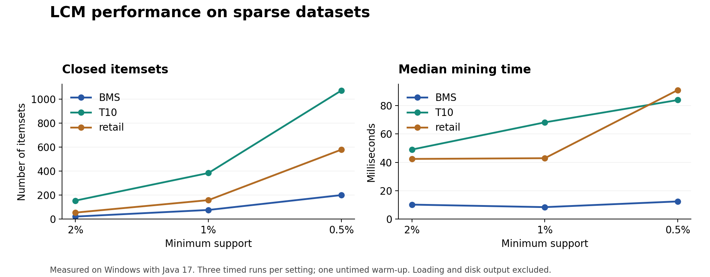

# LCM in Java

Educational Java implementation of **LCM (Linear time Closed itemset Miner)** for frequent closed itemset mining, with exhaustive correctness checks and benchmark measurements on 14 transactional datasets.

**Muzna Farooq · M2 DKAI · Université Paris-Saclay**

The project explores how minimum support affects the number of closed itemsets and mining runtime. It uses prefix-preserving closure extension and occurrence delivery, with no external Java dependencies.

## Results at a glance

| Validation and evaluation | Result |
| --- | --- |
| Correctness validation | 657 exhaustive comparisons on 100 seeded random databases passed |
| Provided datasets tested | 14 |
| Dataset and support combinations | 51 |
| Completed combinations | 46 |
| Combinations reaching the configured limit | 5 |
| Timing method | Median of 3 runs after 1 untimed warm-up |

The benchmark measures mining time separately from file loading, with pattern-file output disabled. The five timeouts are chess at 40%, kr-vs-kp at 40%, and connect at 80%, 60%, and 40%.



See the [full performance report](reports/LCM-Performance-Report.docx), [main benchmark results](results/my-results.csv), and [additional sparse benchmark results](results/my-sparse-results.csv).

## Algorithm

A frequent itemset appears in at least the required number of transactions. It is **closed** when none of its proper supersets has the same support.

The miner follows these steps:

1. Read transactions, remove duplicate items within each transaction, and map the sorted original item IDs to consecutive internal IDs.
2. Start with every transaction and calculate the closure of the empty itemset.
3. Scan the current supporting transactions to count each item. Items in every supporting transaction form the closure.
4. Reject an extension if its closure introduces an item below the extension index that was absent from its parent. This prefix-preserving check prevents duplicate enumeration.
5. Output the accepted nonempty closure and its support.
6. Build local occurrence lists for frequent extension items from the horizontal rows, then recurse using only their supporting transactions.

The recursion keeps the **extension index**, even if the closure contains larger items. The empty itemset is excluded from output. Duplicate transaction rows are retained because each contributes to support. Blank lines and lines beginning with `#`, `%`, or `@` are ignored.

## Quick start

Use **JDK 17 or later**, including `javac`. Open a terminal at the repository root.

```bash
javac LCM.java LCMTest.java
java LCMTest
java LCM datasets/lazaar.txt 3 patterns.txt
```

Expected correctness-test output:

```text
PASS: 657 exhaustive comparisons over 100 random databases.
```

At absolute support 3, the supplied toy dataset has one nonempty frequent closed itemset. `patterns.txt` contains:

```text
1 #SUP: 3
```

For a percentage threshold:

```bash
java -Xmx1g LCM datasets/mushroom.txt "40%" mushroom-patterns.txt
```

`3` means an absolute support count. `"40%"` means the transaction count multiplied by 0.40, rounded up. The single-dataset command has a five-minute limit; if reached, its output is partial and the process exits with code 2.

## Reproduce the benchmarks

Run all provided datasets at 80%, 60%, and 40% support:

```bash
java -Xmx1g LCM --benchmark datasets 80,60,40 3 local-main-results.csv
```

For the additional sparse tests, copy BMS, T10, and retail into `sparse-datasets`. In Windows PowerShell:

```powershell
New-Item -ItemType Directory -Path sparse-datasets -Force
Copy-Item datasets/BMS.txt,datasets/T10.txt,datasets/retail.txt -Destination sparse-datasets
java -Xmx1g LCM --benchmark sparse-datasets 2,1,0.5 3 local-sparse-results.csv
```

On Linux or macOS, use:

```bash
mkdir -p sparse-datasets
cp datasets/BMS.txt datasets/T10.txt datasets/retail.txt sparse-datasets/
java -Xmx1g LCM --benchmark sparse-datasets 2,1,0.5 3 local-sparse-results.csv
```

Run the commands sequentially. Each warm-up or measured mining run has an approximate 30-second limit. Timeout rows intentionally have no complete count or timing median. Recorded measurements in `results/` are preserved; new local measurements use separate output filenames.

## Measured performance

Environment: **Windows, Eclipse Temurin OpenJDK 17.0.20.1, maximum Java heap 1 GiB**. The heap setting is a limit, not a memory measurement. Runtime varies with the machine, JVM, garbage collection, and background activity.

### Main benchmark

Median mining times in milliseconds. `TIMEOUT` means a required run reached the configured limit, rather than an exact completed runtime. Values of `0.000` reflect rounding below the displayed precision.

| Dataset | Transactions | 80% median ms | 60% median ms | 40% median ms |
| --- | ---: | ---: | ---: | ---: |
| anneal.txt | 812 | 60.842 | 607.134 | 3400.266 |
| BMS.txt | 59,602 | 6.864 | 6.574 | 5.456 |
| chess.txt | 3,196 | 611.610 | 13720.387 | TIMEOUT |
| connect.txt | 67,557 | TIMEOUT | TIMEOUT | TIMEOUT |
| kr-vs-kp.txt | 3,196 | 751.264 | 12538.428 | TIMEOUT |
| lazaar.txt | 5 | 0.000 | 0.001 | 0.003 |
| lymph.txt | 148 | 1.175 | 4.063 | 19.526 |
| mushroom.txt | 8,124 | 4.529 | 8.879 | 38.244 |
| pumsb_star.txt | 49,046 | 8.307 | 450.120 | 14043.450 |
| retail.txt | 88,162 | 7.087 | 7.217 | 18.600 |
| soybean.txt | 630 | 0.327 | 0.872 | 2.738 |
| T10.txt | 100,000 | 8.138 | 7.864 | 8.335 |
| Tic-Tac-Tae.txt | 958 | 0.043 | 0.031 | 0.084 |
| vote.txt | 435 | 0.010 | 0.052 | 0.419 |

### Additional sparse tests

All nine combinations completed.

| Dataset | Support | Minimum count | Closed itemsets | Median mining ms |
| --- | ---: | ---: | ---: | ---: |
| BMS.txt | 2% | 1193 | 22 | 10.261 |
| BMS.txt | 1% | 597 | 77 | 8.484 |
| BMS.txt | 0.5% | 299 | 201 | 12.492 |
| T10.txt | 2% | 2000 | 155 | 48.966 |
| T10.txt | 1% | 1000 | 385 | 68.106 |
| T10.txt | 0.5% | 500 | 1,073 | 83.812 |
| retail.txt | 2% | 1764 | 55 | 42.387 |
| retail.txt | 1% | 882 | 159 | 42.898 |
| retail.txt | 0.5% | 441 | 580 | 90.838 |

### Interpretation

- Anneal grows from 1,395 closed itemsets at 80% support to 143,829 at 40%; median runtime rises from 60.842 to 3,400.266 ms, about 55.9 times.
- BMS and T10 have no patterns at the three higher thresholds. At 0.5%, they produce 201 and 1,073 closed itemsets. Retail produces 580 at 0.5%.
- Lower support increases the number of patterns, but observed runtime is not always monotonic: BMS takes 10.261 ms at 2% and 8.484 ms at 1%. Short timings and JVM effects can vary.
- Dense workloads can exceed this teaching implementation's time budget, as the chess, kr-vs-kp, and connect timeouts show.

## Project files

| Path | Purpose |
| --- | --- |
| `LCM.java` | Closed itemset miner and benchmark CLI |
| `LCMTest.java` | Independent brute-force correctness oracle |
| `datasets/` | The 14 datasets supplied for the coursework |
| `results/` | Measured main and sparse benchmark CSVs |
| `reports/LCM-Performance-Report.docx` | Algorithm, methodology, results, and discussion |
| `assets/sparse-performance.png` | Chart generated from the sparse benchmark CSV |
| `.gitignore` | Excludes compiled classes and local generated outputs |

## Implementation limits

This is an educational implementation of LCM's search and occurrence-delivery approach. It retains original horizontal rows and represents conditional databases by transaction-ID lists. It omits production optimizations such as weighted transaction merging, sweep pointers, and specialized bitmaps. The original optimized LCM complexity guarantee should not be claimed for this Java implementation. Memory consumption was not profiled. No comparison with another algorithm is included.

## References and context

Developed as part of the Frequent Itemset Mining coursework in the M2 DKAI programme at Université Paris-Saclay. The datasets were supplied with the coursework; they are input data rather than data created for this project.

- [Takeaki Uno's LCM algorithm and implementation documentation](https://research.nii.ac.jp/~uno/code/lcm.html)
- Uno, Asai, Uchida, and Arimura, *An Efficient Algorithm for Enumerating Closed Patterns in Transaction Databases*, Discovery Science, 2004.
